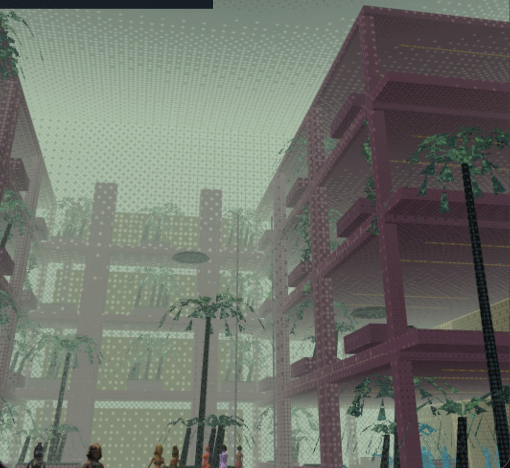
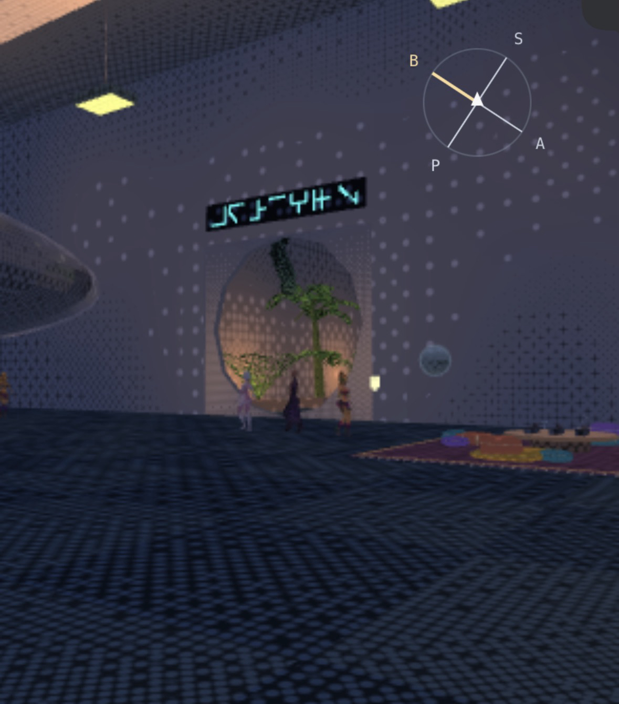

Interiors taking a while, been using [@runevision.bsky.social](https://bsky.app/profile/did:plc:j3akfdyjqu54vpp7dzx54qh4) ‘s Dither3D on surfaces and it looks cool to my eye, but is not yet ready for primetime.

\#rasdFastwalkerLeague
\#GCUArbitraryVisit

[View on Bluesky](https://bsky.app/profile/sesheta.chipchirp.digital/post/3mzh4ck3vts22)
