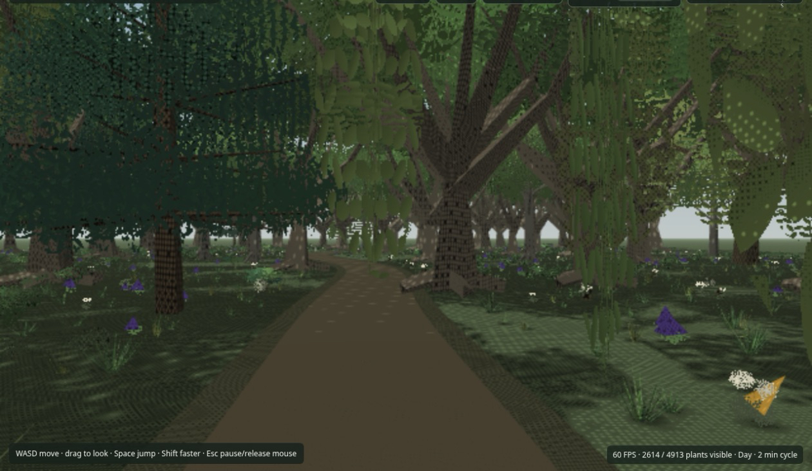

Last night I was working on a forest walking path with day/night cycling. 
Currently considering such environments “Interiors” which would make forests a sort of “building,” and having only the canopy render at distance since the player is expected to be flying.

\#rasdFastwalkerLeague

[View on Bluesky](https://bsky.app/profile/sesheta.chipchirp.digital/post/3n2jm55ximc2y)
