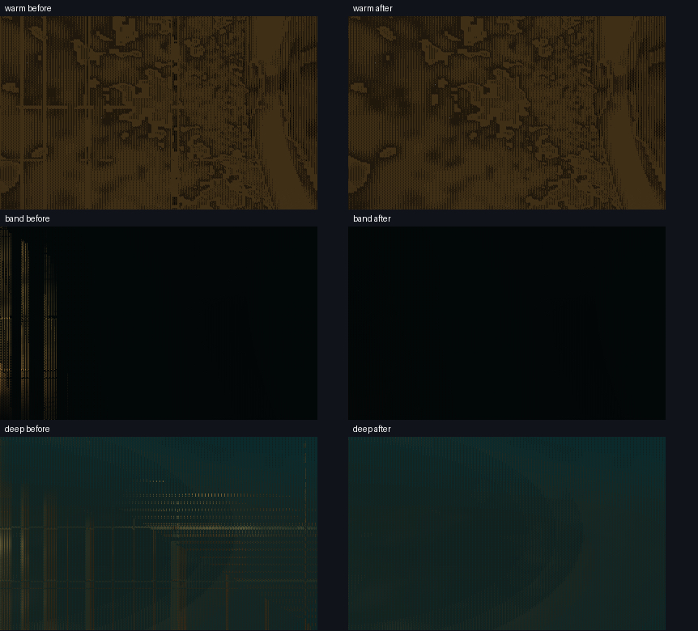

At half resolution, cloud samples landed exactly between depth pixels. Floating-point rounding picked different cloud decks in different rows and columns. 
\#rasdFastwalkerLeague

[View on Bluesky](https://bsky.app/profile/sesheta.chipchirp.digital/post/3n2ztz2uktk26)
